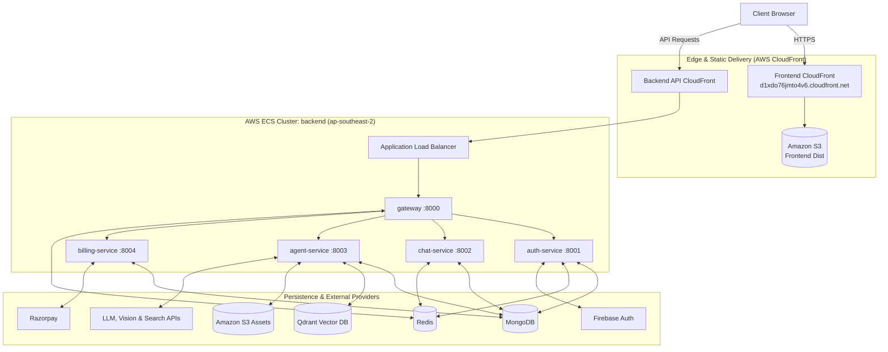

# Synaptra AI

[](https://d1xdo76jmto4v6.cloudfront.net)
[](https://react.dev/)
[](https://nodejs.org/)
[](https://aws.amazon.com/)
[](https://github.com/features/actions)
[](LICENSE)

**Synaptra AI** is a full-stack, multi-agent AI SaaS platform engineered with a containerized microservices architecture on AWS. It combines real-time conversational AI, an interactive Monaco code workspace with live browser previews, Retrieval-Augmented Generation (RAG) over PDFs, vision analysis, image generation, live web search, and subscription billing.

**Live Application:** [https://d1xdo76jmto4v6.cloudfront.net](https://d1xdo76jmto4v6.cloudfront.net)

---

## Table of Contents

- [Core Capabilities](#core-capabilities)
- [Technology Stack](#technology-stack)
- [System Architecture](#system-architecture)
- [Microservices Overview](#microservices-overview)
- [Repository Structure](#repository-structure)
- [Environment Configuration](#environment-configuration)
- [Local Development Setup](#local-development-setup)
- [AWS Cloud Architecture](#aws-cloud-architecture)
- [Automated CI/CD Pipeline](#automated-cicd-pipeline)
- [API Gateway Routing](#api-gateway-routing)
- [Production Operations and Security](#production-operations-and-security)
- [License](#license)

---

## Core Capabilities

### Multi-Agent Conversational Intelligence
- **Dynamic Agent Routing:** Routes prompts across specialized reasoning, coding, search, document, and vision workflows orchestrated via LangGraph.
- **Persistent History:** Stores multi-turn conversation threads and message metadata in MongoDB with Redis-backed session caching.
- **Rich Output Rendering:** Renders GitHub-Flavored Markdown, structured tables, and syntax-highlighted code blocks.

### Live Coding Workspace and Artifacts
- **Integrated Monaco Editor:** Multi-file code viewer supporting syntax detection across 20+ languages.
- **Sandboxed Live Preview:** Compiles and renders generated HTML, CSS, and JavaScript (including JSX/Babel) inside an isolated `iframe` directly alongside the chat stream.

### Multimodal Document and Vision Processing
- **PDF Knowledge Retrieval:** Indexes uploaded PDF documents into Qdrant vector storage for grounded question answering.
- **Vision and Image Generation:** Supports image attachment inspection alongside text-to-image generation with S3 asset storage.
- **Real-Time Web Search:** Integrates Tavily search to ground responses in live web data.

### Authentication and Subscription Billing
- **Identity Management:** End-to-end authentication using Firebase Authentication on the client and Firebase Admin SDK verification on the server.
- **Subscription Lifecycle:** Razorpay integration supporting order creation, cryptographic payment signature verification, webhook event processing, and Free/Pro tier enforcement.

---

## Technology Stack

### Frontend

| Layer | Technologies |
| :--- | :--- |
| **Framework & Build** | React, Vite |
| **State Management** | Redux Toolkit |
| **Styling & Motion** | Tailwind CSS, `motion/react`, Lucide Icons |
| **Code & Content** | `@monaco-editor/react`, `react-markdown`, `remark-gfm`, `react-syntax-highlighter` |
| **Auth & Payments** | Firebase Web SDK, Razorpay Checkout |

### Backend & Infrastructure

| Layer | Technologies |
| :--- | :--- |
| **Runtime & API** | Node.js (v20+), Express |
| **AI & Orchestration** | LangGraph, Groq, Google Gemini, OpenRouter, Tavily Search, Pollinations |
| **Databases & Cache** | MongoDB, Redis, Qdrant (Vector Database) |
| **Cloud & Containers** | Docker, AWS ECS, Amazon ECR, Application Load Balancer (ALB), Amazon S3, Amazon CloudFront |
| **Automation** | GitHub Actions |

---

## System Architecture



---

## Microservices Overview

| Service | Default Port | Core Responsibilities |
| :--- | :---: | :--- |
| **`gateway`** | `8000` | Single public entry point handling CORS, request validation, Redis session checks, auth middleware, and reverse-proxying to downstream services. |
| **`auth-service`** | `8001` | Verifies Firebase ID tokens via Firebase Admin, manages user profiles in MongoDB, and maintains session state in Redis. |
| **`chat-service`** | `8002` | Manages conversation threads, message persistence, title updates, and paginated history retrieval. |
| **`agent-service`** | `8003` | Executes LangGraph agent pipelines, code artifact generation, PDF ingestion/RAG via Qdrant, Tavily web search, and image generation. |
| **`billing-service`** | `8004` | Creates Razorpay orders, verifies payment signatures, handles asynchronous webhooks, and manages Pro subscription entitlements. |

---

## Repository Structure

```text
Synaptra_AI/
├── .github/
│   └── workflows/
│       └── deploy.yml              # Automated AWS ECS + S3/CloudFront CI/CD pipeline
├── frontend/
│   ├── public/
│   ├── src/
│   │   ├── assets/
│   │   ├── components/
│   │   │   ├── Artifact.jsx        # Split-pane Monaco editor & sandboxed live preview
│   │   │   ├── BillingDrawer.jsx   # Razorpay subscription checkout UI
│   │   │   ├── ChatArea.jsx        # Active conversation container
│   │   │   ├── ChatInput.jsx       # Multimodal prompt, file upload & agent mode selector
│   │   │   ├── LoadingAnimation.jsx
│   │   │   ├── MessageBubble.jsx   # Markdown, code copy, and image lightbox renderer
│   │   │   ├── MessageList.jsx
│   │   │   ├── Nav.jsx
│   │   │   └── SideBar.jsx         # Thread navigation and user account controls
│   │   ├── features/               # API service modules
│   │   ├── pages/
│   │   ├── redux/                  # Store and slices
│   │   ├── App.jsx
│   │   ├── main.jsx
│   │   └── index.css
│   ├── utils/
│   │   ├── axios.js
│   │   └── firebase.js
│   ├── .env.example
│   ├── package.json
│   └── vite.config.js
├── backend/
│   ├── gateway/
│   │   ├── controllers/
│   │   ├── middleware/
│   │   ├── utils/
│   │   ├── Dockerfile
│   │   ├── index.js
│   │   └── package.json
│   ├── services/
│   │   ├── auth/
│   │   │   ├── config/
│   │   │   ├── controllers/
│   │   │   ├── models/
│   │   │   ├── routes/
│   │   │   ├── Dockerfile
│   │   │   └── index.js
│   │   ├── chat/
│   │   │   ├── config/
│   │   │   ├── controllers/
│   │   │   ├── models/
│   │   │   ├── routes/
│   │   │   ├── Dockerfile
│   │   │   └── index.js
│   │   ├── agent/
│   │   │   ├── agents/
│   │   │   ├── config/
│   │   │   ├── controllers/
│   │   │   ├── graph/              # LangGraph state machines and nodes
│   │   │   ├── routes/
│   │   │   ├── utils/
│   │   │   ├── Dockerfile
│   │   │   └── index.js
│   │   └── billing/
│   │       ├── config/
│   │       ├── controllers/
│   │       ├── models/
│   │       ├── routes/
│   │       ├── Dockerfile
│   │       └── index.js
│   ├── shared/
│   │   └── redis/
│   ├── docker-compose.yml
│   └── package.json
└── README.md
```

---

## Environment Configuration

Create a `.env` file in the frontend and each backend service directory before running locally. Never commit `.env` files or service account keys to version control.

### Frontend (`frontend/.env`)

```env
VITE_SERVER_URL=http://localhost:8000
VITE_FIREBASE_API_KEY=your_firebase_web_api_key
VITE_RAZORPAY_KEY_ID=your_razorpay_key_id
```

### API Gateway (`backend/gateway/.env`)

```env
PORT=8000
FRONTEND_URL=http://localhost:5173
REDIS_URL=redis://localhost:6381

AUTH_SERVICE=http://localhost:8001
CHAT_SERVICE=http://localhost:8002
AGENT_SERVICE=http://localhost:8003
BILLING_SERVICE=http://localhost:8004
```

### Auth Service (`backend/services/auth/.env`)

```env
PORT=8001
MONGODB_URI=mongodb://localhost:27017/synaptra_auth
REDIS_URL=redis://localhost:6381
FIREBASE_PROJECT_ID=your_firebase_project_id
```

### Chat Service (`backend/services/chat/.env`)

```env
PORT=8002
MONGODB_URI=mongodb://localhost:27017/synaptra_chat
REDIS_URL=redis://localhost:6381
```

### Agent Service (`backend/services/agent/.env`)

```env
PORT=8003
MONGODB_URI=mongodb://localhost:27017/synaptra_agent
REDIS_URL=redis://localhost:6381
CHAT_SERVICE=http://localhost:8002
AUTH_SERVICE=http://localhost:8001

GROQ_API_KEY=your_groq_api_key
GOOGLE_API_KEY=your_google_api_key
OPENROUTER_API_KEY=your_openrouter_api_key
TAVILY_API_KEY=your_tavily_api_key
POLLINATIONS_API_KEY=your_pollinations_api_key

AWS_REGION=ap-southeast-2
AWS_ACCESS_KEY_ID=your_aws_access_key_id
AWS_SECRET_ACCESS_KEY=your_aws_secret_access_key
AWS_BUCKET_NAME=your_s3_assets_bucket

QDRANT_URL=https://your-qdrant-cluster-url
QDRANT_API_KEY=your_qdrant_api_key
```

### Billing Service (`backend/services/billing/.env`)

```env
PORT=8004
MONGODB_URI=mongodb://localhost:27017/synaptra_billing
RAZORPAY_KEY_ID=your_razorpay_key_id
RAZORPAY_KEY_SECRET=your_razorpay_key_secret
RAZORPAY_WEBHOOK_SECRET=your_razorpay_webhook_secret
```

---

## Local Development Setup

### Prerequisites

- **Node.js** v20.0.0 or higher
- **Docker & Docker Compose** (for local Redis)
- **MongoDB** (local instance or MongoDB Atlas URI)
- **Qdrant** (local container or Qdrant Cloud cluster)
- Active API keys for Firebase, Razorpay, and configured LLM/Search providers

### 1. Clone and Install Dependencies

```bash
git clone [https://github.com/yashch3101/synaptra_ai.git](https://github.com/yashch3101/synaptra_ai.git)
cd synaptra_ai

npm --prefix frontend install
npm --prefix backend/gateway install
npm --prefix backend/services/auth install
npm --prefix backend/services/chat install
npm --prefix backend/services/agent install
npm --prefix backend/services/billing install
```

### 2. Start Redis via Docker Compose

```bash
docker compose -f backend/docker-compose.yml up -d
```

*Note: Docker Compose maps container port `6379` to host port `6381`.*

### 3. Run Backend Microservices

Start each service in its own terminal session:

```bash
npm --prefix backend/gateway run dev
npm --prefix backend/services/auth run dev
npm --prefix backend/services/chat run dev
npm --prefix backend/services/agent run dev
npm --prefix backend/services/billing run dev
```

### 4. Run the Frontend Development Server

```bash
npm --prefix frontend run dev
```

Access the application at `http://localhost:5173`.

### Building Service Containers Locally

```bash
docker build -f backend/gateway/Dockerfile -t gateway backend
docker build -f backend/services/auth/Dockerfile -t auth-service backend
docker build -f backend/services/chat/Dockerfile -t chat-service backend
docker build -f backend/services/agent/Dockerfile -t agent-service backend
docker build -f backend/services/billing/Dockerfile -t billing-service backend
```

---

## AWS Cloud Architecture

All production resources are provisioned in the **Asia Pacific (Sydney) — `ap-southeast-2`** region.

1. **Amazon Elastic Container Registry (ECR):**
   Hosts private Docker image repositories for `gateway`, `auth-service`, `chat-service`, `agent-service`, and `billing-service`.
2. **Amazon Elastic Container Service (ECS):**
   Runs all five microservices inside the `backend` ECS cluster using rolling deployments (`--force-new-deployment`) with environment variables injected via task definitions.
3. **Application Load Balancer (ALB):**
   Routes incoming API traffic to healthy `gateway` tasks, configured with an extended idle timeout (`120s`) to accommodate long-running multimodal and image generation requests.
4. **Amazon S3 & CloudFront (Frontend):**
   The production Vite bundle (`frontend/dist`) is synced to an S3 bucket and served globally over HTTPS via CloudFront (`https://d1xdo76jmto4v6.cloudfront.net`).
5. **Amazon CloudFront (Backend API):**
   A dedicated CloudFront distribution sits in front of the ALB to provide HTTPS termination for API requests from the CloudFront-hosted frontend, with origin response timeouts extended (`60s`) for AI inference workloads.

---

## Automated CI/CD Pipeline

Continuous deployment is automated via GitHub Actions in `.github/workflows/deploy.yml` and triggers on every push to the `main` branch.

### Pipeline Stages

1. **`deploy-backend`**
   - Configures AWS credentials using an IAM deployment user (`AmazonEC2ContainerRegistryFullAccess`, `AmazonECS_FullAccess`).
   - Authenticates Docker with Amazon ECR in `ap-southeast-2`.
   - Builds, tags (`:latest`), and pushes images for all five services (`gateway`, `auth-service`, `chat-service`, `agent-service`, `billing-service`).
   - Executes `aws ecs update-service --force-new-deployment` across all five ECS services to pull the latest images with zero downtime.

2. **`deploy-frontend`** *(runs after `deploy-backend` succeeds)*
   - Injects `VITE_SERVER_URL`, `VITE_FIREBASE_API_KEY`, and `VITE_RAZORPAY_KEY_ID` into the build environment.
   - Compiles the production bundle via `npm run build` inside `frontend/`.
   - Syncs `frontend/dist` to the production S3 bucket (`aws s3 sync --delete`).
   - Triggers a CloudFront cache invalidation (`/*`) so users immediately receive the latest release.

### Required GitHub Repository Secrets

| Secret Name | Description |
| :--- | :--- |
| `AWS_REGION` | Target AWS region (`ap-southeast-2`) |
| `AWS_ACCOUNT_ID` | 12-digit AWS account identifier |
| `AWS_ACCESS_KEY` | IAM access key ID for CI/CD deployments |
| `AWS_SECRET_ACCESS_KEY` | IAM secret access key for CI/CD deployments |
| `ECS_CLUSTER` | ECS cluster name (`backend`) |
| `GATEWAY_SERVICE` | ECS service name for the API gateway |
| `AUTH_SERVICE` | ECS service name for the auth service |
| `CHAT_SERVICE` | ECS service name for the chat service |
| `AGENT_SERVICE` | ECS service name for the agent service |
| `BILLING_SERVICE` | ECS service name for the billing service |
| `VITE_SERVER_URL` | Production HTTPS URL of the backend CloudFront distribution |
| `VITE_FIREBASE_API_KEY` | Firebase Web API key |
| `VITE_RAZORPAY_KEY_ID` | Razorpay public key ID |
| `S3_BUCKET` | Target S3 bucket hosting `frontend/dist` |
| `CLOUDFRONT_DISTRIBUTION_ID` | CloudFront distribution ID for cache invalidation |

---

## API Gateway Routing

All client requests enter through the `gateway` service (`/api/*`) and are proxied internally:

| Path Prefix | Downstream Service | Description |
| :--- | :--- | :--- |
| `/api/auth/*` | `auth-service` | Token verification, login/logout, and user profile lookup |
| `/api/chat/*` | `chat-service` | Thread creation, history listing, and message persistence |
| `/api/agent/*` | `agent-service` | Chat completions, code artifacts, PDF Q&A, vision, and image generation |
| `/api/billing/*` | `billing-service` | Subscription plans, Razorpay order creation, verification, and webhooks |
| `/api/me` | `gateway` | Authenticated session and user context resolution |

---

## Production Operations and Security

- **Long-Running AI Requests:** Ensure client Axios timeouts (`120000ms`), Backend CloudFront Origin Response Timeout (`60s`), and ALB Idle Timeout (`120s`) are aligned so image generation and RAG pipelines do not terminate prematurely.
- **CORS & Domain Allowlisting:** Register the production CloudFront domain (`d1xdo76jmto4v6.cloudfront.net`) in both the Gateway `FRONTEND_URL` variable and **Firebase Console -> Authentication -> Settings -> Authorized domains**.
- **Secret Hygiene:** Keep `.env` files excluded via `.gitignore` and inject runtime secrets into ECS containers through AWS Secrets Manager or ECS task environment parameters.

---

## License

This project is licensed under the [MIT License](LICENSE).